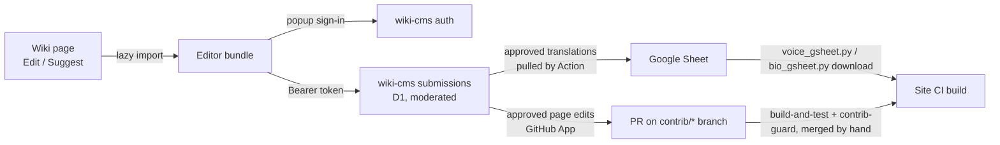

# Contributor editing (no GitHub account needed)

Signed-in readers can suggest voice/bio translations and edit page text from the wiki itself. This page keeps what the code and its comments do not say: the goals, the decisions and their reasons, the gotchas, and what was designed but not built. The mechanics are in the code and in the docs linked at the end.

## How it fits together

- **Translations (voice lines, bios)**: moderated wiki-cms submissions (`lah-voice-tl`, `lah-bio-tl`) that the hourly `translation-intake.yml` Action writes into the Google Sheet.
- **Page edits**: a moderated submission (`lah-page-edit`) that wiki-cms turns into a pull request through a GitHub App; `contrib-guard.yml` is the gate.
- **Sign-in** is shared with the Team Creator (wiki-cms contributor accounts). The popup offers **Discord** or **Bluesky** (atproto OAuth, handle entered in the popup, identity only; account age from the `did:plc` creation date in plc.directory; two separate contributors, no linking). The wiki does not know which one the user picks, so every sign-in string is provider-neutral and `signIn()` sends no provider. X was dropped because its API pricing is too high for this wiki. Design and decisions: wiki-cms `docs/BLUESKY_LOGIN_PLAN.md`. Bluesky avatars come from `cdn.bsky.app` (the wiki sets no CSP, so nothing to allow).

## Goals and constraints

- The editor JavaScript loads only when someone clicks Edit / Suggest (hover, focus and touch prefetch it so the sign-in popup can open inside the click). Pages must not get heavier for readers.
- **No custom domain.** The wiki (`github.io`) and wiki-cms (`workers.dev`) are both on the Public Suffix List, and Safari blocks third-party cookies, so the wiki-cms cookie never reaches wiki pages. That is the whole reason for the popup + `postMessage` + own bearer token design instead of cookies.
- **The Google Sheet stays the source of truth** for voice and bio translations (translators work in it directly). The Worker never holds Google credentials, so a GitHub Action does the sheet writes.
- **Game text always wins.** A line or bio is translatable into a language only while the game's text in that language is missing or equal to JP. The editor offers Suggest only then, the renderer prefers game text, and sheet text the game later supersedes is just not shown (the intake marks such submissions `superseded`).
- New contributed HTML is limited to `
`, `
`, ` ` and table tags. Richer markup is for people using GitHub directly.
- Long-term contributors should still end up on GitHub: the toolbar keeps an "Edit on GitHub" link (`/edit/master/<path>`, which forks automatically) next to the new "Edit" button.
- Out of scope: skill translation (stays in its own Google Sheet).

## Decisions and why

- **Moderated before anything touches the repo or the sheet.** Spam never reaches GitHub or the sheet; the cost is one moderator click.
- **PRs are always merged by hand.** The App never enables auto-merge. Revisit only if volume makes it a chore, together with a trust level (see below).
- **Attribution lives only in git history (the `Co-authored-by` trailer) and the sheet's `source` / `zhHansSource` / `zhHantSource` / `jpSource` columns** (`wiki-cms #<first 8 chars of id> (<display name>)`). No contributors page, no per-page "edited by".
- **Page edits replace the whole body, not one section.** A section splitter would need a markdown-aware heading parser, a rule for Liquid blocks that cross headings, and a section index stable between edit and approval. The guard is token-based, so it works on any span of text. Front matter is never shown; the Worker re-attaches the base file's front matter.
- **The submission carries only `after` plus `baseSha`.** The Worker re-fetches the base file at `baseSha` when it needs `before` (diff view), so nothing is sent twice. `lah-page-edit` has its own 128 KB body cap (`guide/sale.md` is 35 KB; wiki-cms's default is 32 KB and stays for every other route).
- **No automatic merge of conflicts.** A stale `baseSha` becomes a `conflict`; the moderator edits `after` and sets the new `baseSha`. Revisit only if conflicts are frequent.
- **Voice suggestions are batched per voice table** (one button per table, one submission per language and resource, at most 100 lines), not one submission per line. It keeps page HTML small and moderation sane.
- **Chinese suggestions are translated from the Japanese text**, so a roster entry needs a non-empty `jp` first; the sheet-only "manual" voice parts (`battleStart` …) have no game JP, so an English submission may carry a `jp` transcription. The contributor's transcription is preferred over the text `voice_scraper.py` scraped from the JP wiki (`upload` skips the `jp` of rows with a `jpSource`).
- **Bio translation is only for characters the game has not localized.** A community bio tab is labelled "(community translation)" and disappears in favour of the game text as soon as the game ships it.
- **No shared service account for PRs.** A GitHub App (short-lived tokens, one repo, no `workflows` permission, not a bypass actor on `master`) instead of a PAT tied to a person. Worst case on a leaked key: junk PRs and pushes to `contrib/*`, never `master` or workflows.
- **Account age gate:** the provider account must be 30 days old when first becoming a contributor, as a cheap bot filter on top of moderation, Turnstile and the IP limits.

## The guard (why it looks the way it does)

- Page bodies already contain Liquid (`for`, `assign`, `{{ … }}`, raw blocks) and HTML. Rejecting every `{%` would block edits to the plain text around them, so the guard compares the body **before and after**: free tokens (`chara_link`, allowed `include`s with literal parameters) may change; the ordered sequence of every other token must be byte-identical.
- **Include allowlist = `_includes/*.html` minus `INCLUDE_DENYLIST`** (in `wiki_plugins/lib/contrib-guard.js`). `quest-group`, `shop-table`, `skill-table-manual` and `apache-chart` are deliberately allowed, as long as the call uses literal parameters; an existing call that uses variables or filters stays protected like any other non-free token. When you add an include that must not be contributor-editable (page chrome, generated pieces, anything reading page data), add it to the denylist.
- **One implementation, three places:** the same file runs in the editor (instant, names the offending token), in CI (authoritative) and in the Eleventy build (`/api/contrib-includes.json`). The Worker only checks structure (path, `baseSha`, size, front matter fence) because it cannot import wiki code and a copy would drift.
- **The CI job is safe on untrusted PRs only because of how it is wired** (`contrib-guard.yml`): `pull_request_target`, checkout of the **base** branch, the PR head fetched as data and read with `git show`, no dependency install, no secrets. Do not "simplify" it into a normal `pull_request` job or check out the head, or a PR can weaken its own guard.
- A skipped job counts as passing for a required check, and the job only runs for `contrib/*` heads, so keep "require a pull request / approval" in the `master` ruleset as well.

## Gotchas

- **Squash merge:** re-approving an edit after a pending round trip fast-forwards the same `contrib/<id>` branch with a commit that has two parents (so the PR diff stays this one file). The branch history is therefore not linear, so prefer squash merging.
- **Rosters are cached.** `voice-roster.json` / `bio-roster.json` are served by the wiki build (`translation-rosters.11ty.js`) and read by wiki-cms from KV, which its hourly cron fills; a newly added type has no translatable-line check for up to an hour (`cms republish` forces it). The check is soft: a missing roster never blocks submissions.
- **The intake rebuilds the rosters itself** (download sheets, `masterdata.py -f=1 --skip_data`, `gen_translation_rosters.py`) so `superseded` is decided on fresh data. It is idempotent: a line whose sheet text already equals the new text counts as written, and the Worker skips rows that already have an outcome. Intake runs one at a time (`concurrency` group), because two runs would read the same approved rows.
- **Plain text only** in translation submissions (no `<`, `>`, `{%`, `{{`, control characters other than newline), because it ends up in a sheet and then in wiki HTML. Voice line breaks become ` ` in the sheet; bios keep newlines. `voice_gsheet.py download` runs `wiki_util.validateHtml`, so bad text typed directly into the sheet fails the build too.
- **The Bio tab only exists on the site once it is published:** `BIO_CSV_URL` in `tools/bio_gsheet.py` is empty-safe (writes `{}`), the Chinese columns and their source columns are added by `contrib_intake.py` when missing.
- **`translatable.py` replicates `_includes/voice-table.html`'s row universe** (greeting parts, whitelisted SERIF parts, manual parts). Change both together.
- **Game text vs. sheet:** the voice sheet keys are `voice_<resourceName>_<part>`; the resource names are the ones pages pass to `voice-table.html`.
- **`cms-contrib:<api>` in `localStorage`** holds a 30-day token; a 401 means it expired and the editor asks to sign in again. It is never accepted by `/api/admin/*`.
- `web/cms-plugin/api-types.ts` must stay a verbatim copy of wiki-cms `src/shared/api-types.ts`.

## Designed but not built

- **Data edits (`_data/wiki/*.yml`).** Whitelist `VoiceActor.yml`, `Illustrator.yml`, `Affiliation.yml`, `Item.yml` (not `UITranslation.yml`, `SalesReport.json` or generated files). Edit in context with a form (e.g. "Edit voice actor / illustrator" on a chara page opens that entry's fields) instead of raw YAML. One Valibot schema per file, kept here, bundled into the editor and checked again at build (an Eleventy data check that throws, like `cms-groups.js`). The Worker applies the edit with the `yaml` package's Document API so comments, key order and quoting survive and the PR diff shows only the changed lines. Same path as page edits: type `lah-data-edit` → moderation → App PR (plus a CI guard for the whitelist).
- **More sign-in providers.** GitHub (leads people onto GitHub; opt-in `public_repo` scope would later allow PRs from the contributor's own fork under their own name), then Reddit. The registry is `src/core/providers.ts` in wiki-cms (a provider returns a creation date for the same age gate). Account linking across providers is not implemented.
- **Trust level.** `contributor_tab.trust_level` is reserved; the idea is to auto-approve translations from contributors with N accepted edits. Revisit auto-merge only together with this.
- **Getting contributors onto GitHub:** link "your edit is in PR #n" and "you can also edit directly on GitHub" from the submitter's status page, and offer GitHub sign-in after a few accepted edits.
- **Editor polish:** CodeMirror 6, and LiquidJS in the preview if guide pages need more than placeholder chips (today only `chara_link`, `item.html` and `item-icon.html` render for real, from `/api/editor-data.json`; every other include and protected token is a labelled chip).

## Where things live

- Docs: wiki-cms `docs/ARCHITECTURE.md` ("Contributor accounts", "Translation types", "Page edits and the GitHub App"), wiki-cms `docs/SETUP.md` (registering the types, creating the GitHub App, ruleset, secrets, deploy order), [CMS.md](CMS.md) (Team Creator accounts), [PYTHON_SCRIPTS.md](PYTHON_SCRIPTS.md) section 16 (sheet tooling, rosters, intake), `contributing/index.md` (what contributors may do, user-facing).
- Wiki: guard `wiki_plugins/lib/contrib-guard.js` + `scripts/contrib-guard-ci.mjs` + `.github/workflows/contrib-guard.yml`; editor `web/editor/` → `assets/cms/editor.js`; admin plugins `web/cms-tl-plugins/` → `assets/cms/lah-*.js`; loader `setupContrib()` in `assets/main.js`; rosters `tools/gen_translation_rosters.py` + `translation-rosters.11ty.js`; intake `tools/contrib_intake.py` + `.github/workflows/translation-intake.yml`; build outputs `/api/contrib-includes.json`, `/api/editor-data.json`.
