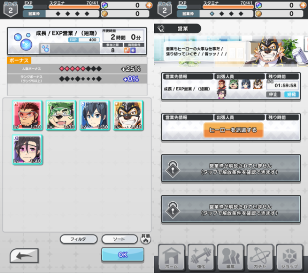

* this will be unordered
{:toc}

## About Sale

You can leave the hero for a set amount of time during the business. Sales reward currency needed to improve your characters: , , and  . All sale types reward some EXP.

## Sale Slot

There are four Sale slots. Initially, only two are unlocked. An additional slot is unlocked after beating Chapter 1 of the [Main Quest](/guide/quest/#main-quest), while the fourth slot is unlockable with a Sale Slot Unlock Ticket purchasable from the [Shop](/guide/shop/) for 10 .

Heroes departed onto an ongoing Sale cannot be assigned onto a different business. However, they are free to participate in [Quests](/guide/quest/).

## Sale Hour

Since v4.14.2, you can collect Sales every hour. However, reward will stop accumulating after 25 hours without collection.
Even while Sales are being dispatched, you can switch an ongoing Sale to a different one.

<!--
Sale can be conducted in set amounts of time: two hours, four hours, eight hours, twelve hours, 16 hours and 24 hours. There is no difference in efficiency as the rewards scale linearly with the amount of time spent, so choose a timing that fits your lifestyle. Note that rewards are cumulative with Sale obtainable experience values.
-->

- EXP Sale: 800  per hour
- Training Band Sale: 800  per hour
- Livo Sale: 1200  per hour

## Sale Obtainable Experience

Experience points will be given to all heroes who have departed on the Sale. In case the hero's level is already at its limit, the experience will be given in the form of item instead. The EXP rewards per type of sale for each amount of time can be found in the table below.

- EXP Sale: 400  per hour
- Training Band Sale: 160  per hour
- Livo Sale: 160  per hour

<!--
| Time   | EXP  | Laf | Training Band |
|:--------:|:------:|:------:|:----------:|
| 2:00h  | 400   | 160   | 160       |
| 4:00h  | 800   | 320   | 320      |
| 8:00h  | 1600  | 640   | 640      |
| 12:00h  | 2400  | 960   | 960      |
| 16:00h | 3200  | 1280  | 1280      |
| 24:00h  | 4800  | 1920   | 1920      |
-->

## Sale Bonus

The amount of currency obtained in each type of Sale is increased by a bonus. Heroes going on the Sale give either a +5% bonus for the first six Heroes and a +10% bonus for the seventh and eighth Heroes, up to maximum of +50% if all eight slots are filled; 5★ Heroes provide an additional +5% for the first six 5★ Heroes and a +10% bonus for the seventh and eighth 5★ Heroes, up to a maximum of 50%. Hence, the maximum total of bonus for each sale is +100% for a team of eight 5★ Heroes. Obtainable experience is also affected by this bonus.

### Efficiency Priority List

1. Fill out every sale slot, since each sale slot gives you 100% rewards.
1. Use every hero you have. Heroes that are used in sale can still participate in battle.
1. Stack one sale to 7/8 members if possible, since the 7th and 8th members will give 10% bonus each instead of 5% bonus.
1. Stack one sale to 7/8 5★ members if possible, since the 7th and 8th 5★ members will give 10% bonus each instead of 5% bonus.

## Sale Shortening and Canceling

Sale can be shortened and canceled.

Sale Shortening Tickets can be used to shorten the duration of a sale. Sale Shortening Ticket come in several tiers of efficacy: bronze, silver, and gold. As a result from shortening, if the sale hour is less than the shortening amount, the sale will be instantly completed.

| Tier   | Shortening amount (mins) |
|:--------:|:------------------------:|
|  | 10                     |
|  | 30                     |
|  | 60                     |

Stopping an ongoing sale will instantly complete the sale, but with no rewards.

## Sidekick Accompaniment

As of ver 2.5.0 after approval process from the office feature, sidekick can accompany heroes on sale, each sidekick has their own bonus you can check it in game.

## Sale Report

After sale is completed, a report will be randomly generated from these templates, with <code>characterX</code> replaced with
the name of the hero(es) sent to the sale. Up to 10 recent Sales report can be viewed.

For special sales report released in events, please see event info pages listed in [Events](/events/).





